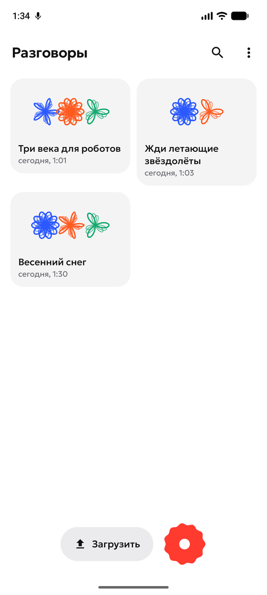
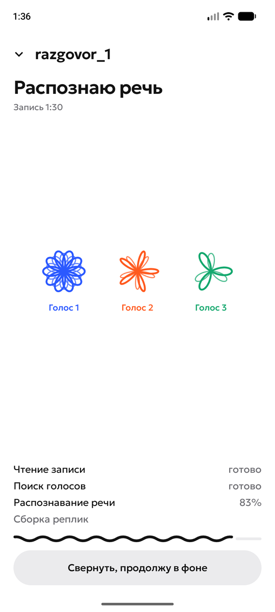
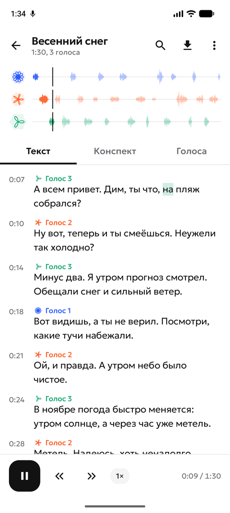
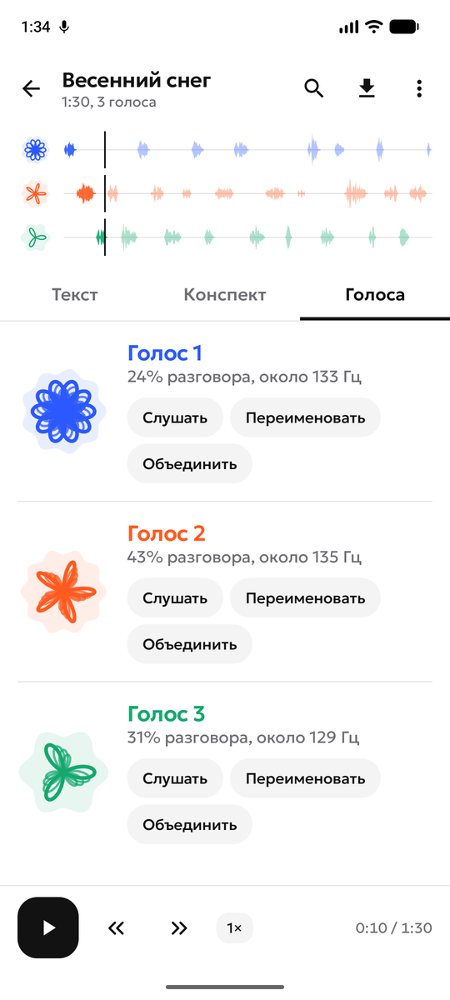
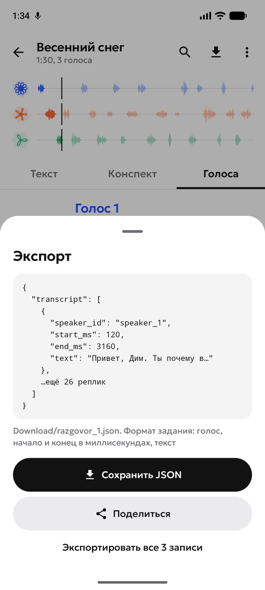

# Реплика

**Кто что сказал — разберёт телефон. Даже в авиарежиме.**

Нейро-стенографист для Android. Без интернета превращает запись разговора в расшифровку: определяет, кто говорит, ставит временные метки реплик, делает конспект локальной языковой моделью и выгружает результат в JSON.

| | |
|---|---|
| Видео работы | _ссылка — добавить_ |
| APK | _ссылка и размер — добавить_ |
| Установка и использование | [ниже](#установка) |
| Архитектура и модели | [docs/ARCHITECTURE.md](docs/ARCHITECTURE.md) |
| Результаты тестов | [docs/TEST_RESULTS.md](docs/TEST_RESULTS.md) |
| Ограничения | [docs/LIMITATIONS.md](docs/LIMITATIONS.md) |

Команда **MISIS G1ants** (НИТУ МИСИС, прикладная информатика), хакатон Nuclear IT Hack 2026.

<p>
  
  
  
  
  
</p>

## Что умеет

- Записать разговор в приложении или загрузить файлы: mp3, m4a, wav, flac, ogg (в том числе голосовые Telegram). Можно выбрать несколько файлов сразу или прислать аудио через «Поделиться» из другого приложения.
- Распознать русскую речь на телефоне (GigaAM v3).
- Определить, кто говорит (Nemotron), склеить слова в реплики с таймкодами. Голоса появляются на экране по ходу обработки.
- Нарисовать каждому голосу свой узор: чем ниже голос, тем меньше лепестков у цветка. Узор — отпечаток голоса, по нему говорящих различают с одного взгляда.
- Показать расшифровку с воспроизведением: дорожки голосов, подсветка текущего слова, переход к реплике, прослушивание одного голоса.
- Найти слово в записи и увидеть совпадения на дорожках голосов.
- Исправить ошибку разметки: объединить два голоса, если модель разделила одного человека; JSON пересобирается.
- Сделать название и конспект записи локальной LLM (llama.cpp): о чём разговор, о чём договорились, кто что сделает — с переходом к моменту записи.
- Экспортировать JSON в формате задания, по одному файлу или все записи сразу.

Все вычисления выполняются на устройстве. У приложения нет разрешения на доступ к сети: это видно в настройках телефона.

## Установка

1. Скачайте APK по ссылке в начале страницы.
2. Разрешите установку из неизвестных источников и установите.
3. Модели уже внутри APK, загружать из сети ничего не нужно. При первом запуске приложение копирует их во внутреннюю память, это идёт в фоне.

Требования: Android 8.0 и новее, процессор arm64, около 2 ГБ свободного места.

## Как пользоваться

1. На главном экране нажмите красную кнопку, чтобы записать разговор, или «Загрузить», чтобы выбрать готовые файлы.
2. Дождитесь обработки. Экран можно свернуть, прогресс виден в уведомлении; несколько файлов обрабатываются по очереди.
3. Откройте расшифровку. Вкладки: «Текст», «Конспект», «Голоса».
4. Значок загрузки сохраняет JSON в папку Download под именем исходного аудиофайла. «Экспортировать все» в меню главного экрана сохраняет все готовые записи.

## Формат результата

```json
{
  "transcript": [
    { "speaker_id": "speaker_1", "start_ms": 1250, "end_ms": 4380, "text": "Добрый день!" }
  ]
}
```

`speaker_id` нумеруются по порядку первого появления голоса, время в миллисекундах от начала исходного файла. Конспект в этот файл не входит, чтобы не смешивать распознанную речь с текстом модели.

## Устройство решения

Подробно — в [docs/ARCHITECTURE.md](docs/ARCHITECTURE.md).

| Этап | Модуль | Модель или инструмент |
|---|---|---|
| Чтение аудио | `speech` | MediaCodec → 16 кГц моно |
| Кто говорит | `diarization` | NVIDIA Nemotron 3 Diarization (ONNX Runtime, int8) |
| Распознавание | `speech` | GigaAM v3 с пунктуацией (sherpa-onnx, int8) |
| Сборка реплик | `diarization` | слова + разметка голосов |
| Название и конспект | `summary`, `summary-android` | llama.cpp, модель Qwen в формате GGUF |
| Весь путь одного файла | `pipeline` | поток событий для интерфейса |
| Интерфейс | `app` | Kotlin, Jetpack Compose, Material 3 |

## Результаты

Методика и цифры — в [docs/TEST_RESULTS.md](docs/TEST_RESULTS.md). Коротко:

- Pixel 7 Pro, разговор 3 минуты 20 секунд: вся обработка 36 с (RTF 0,18), пик памяти 535 МБ.
- Распознавание на 6 русских диалогах: WER 7,5%.
- Диаризация на чистых русских диалогах: 100% слов с верным голосом.

## Ограничения

Подробно — в [docs/LIMITATIONS.md](docs/LIMITATIONS.md). Главное: распознаётся только русская речь, до 8 голосов в записи, одновременная речь не выделяется в отдельные реплики.

## Сборка из исходников

Инструкция — в [src/android/README.md](src/android/README.md).

## Команда

| Роль | Участник |
|---|---|
| Приложение и интерфейс | Екатерина Булгакова |
| Распознавание речи | Антон Лялин |
| Диаризация и обработка | Артём Семёнов |
| Локальная LLM, качество, документы | Максим Клинин |
